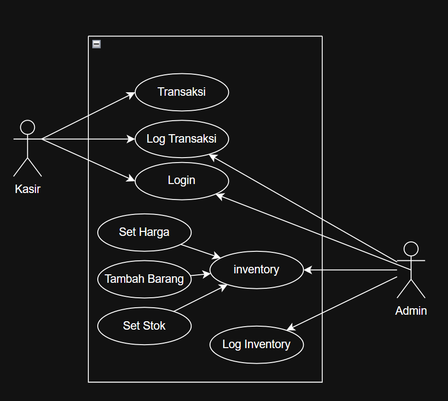
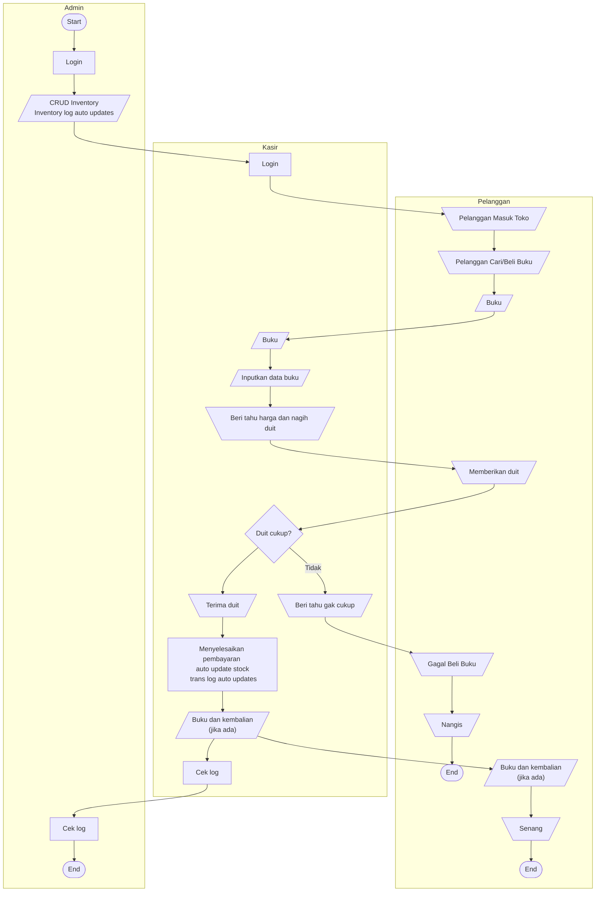
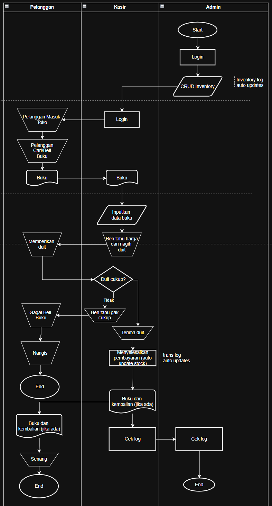
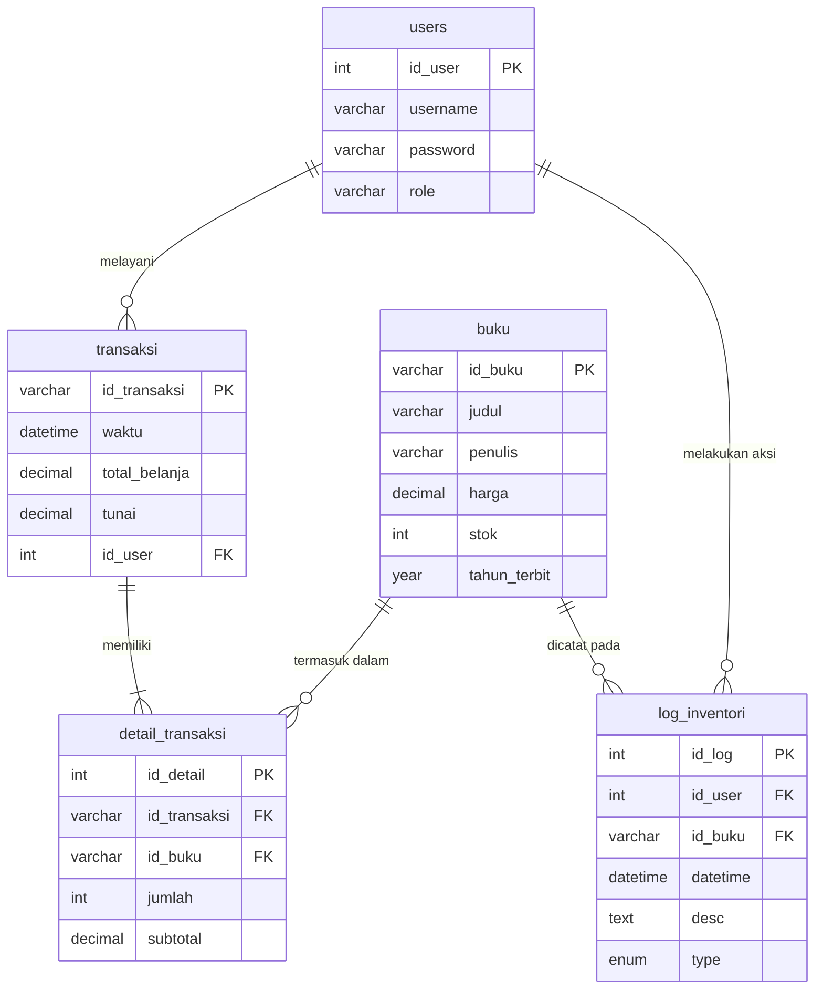
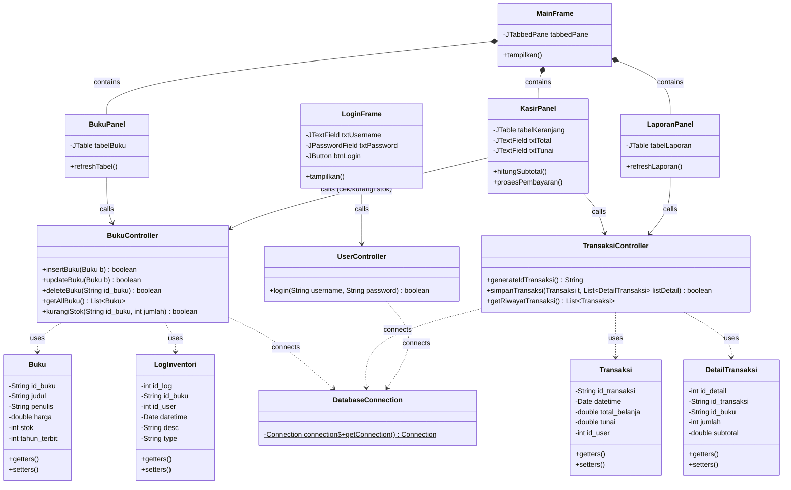

# 📚 Book App - Sistem Point of Sale (POS) & Inventaris Toko Buku

Book App adalah aplikasi desktop berbasis **Java Swing** yang dirancang khusus untuk memecahkan masalah pencatatan manual pada UMKM toko buku. Aplikasi ini mengintegrasikan manajemen stok barang dengan sistem kasir, sehingga setiap transaksi secara otomatis akan memperbarui jumlah stok fisik dan tercatat dalam laporan keuangan.

---

## ✨ Fitur Utama & Alur Kerja (Workflow)

### Fungsionalitas
- 🔐 **Autentikasi (Login):** Pembatasan akses ke dalam sistem khusus untuk Kasir atau Admin.
- 📦 **Manajemen Inventaris (CRUD):** Tambah, ubah, hapus, dan cari data buku berdasarkan judul atau penulis.
- 🛒 **Sistem Kasir:** Antarmuka transaksi kasir dengan perhitungan total belanja, uang tunai, dan kembalian otomatis.
- 📊 **Laporan Transaksi:** Riwayat lengkap penjualan beserta detail buku yang terjual.

### Alur Sistem
1. **Masuk:** Buka aplikasi ➔ Form Login ➔ Verifikasi Database ➔ Masuk ke Dashboard Utama.
2. **Kelola Stok:** Menu *Kelola Buku* ➔ Tampil tabel buku ➔ Klik Tambah/Edit/Hapus ➔ Simpan ➔ Tabel dan database diperbarui.
3. **Kasir/Transaksi:** Menu *Kasir* ➔ Cari buku & masukkan ke keranjang ➔ Subtotal dihitung otomatis ➔ Input uang tunai bayar ➔ Klik *Proses* ➔ Stok database berkurang, transaksi tersimpan, popup kembalian muncul.

---

## 🏗️ Arsitektur Class (Pola MVC)

Aplikasi ini menggunakan pola arsitektur **Model-View-Controller (MVC)** untuk memisahkan data, antarmuka, dan logika bisnis.

*   **`model` (Entitas Data):**
    *   `Buku.java` (id, judul, penulis, harga, stok, tahun_terbit)
    *   `Transaksi.java` (id_transaksi, datetime, total_belanja, tunai, id_user)
    *   `DetailTransaksi.java` (id_detail, id_transaksi, id_buku, jumlah, subtotal)
    *   `LogInventori.java` (id_log, id_buku, id_user, datetime, desc, type)
    *   `users` (id, username, password, role)
*   **`config` (Koneksi Database):**
    *   `DatabaseConnection.java` (Membuka koneksi JDBC ke MySQL)
*   **`controller` (Logika Bisnis):**
    *   `BukuController.java` (Metode CRUD dan pengurang stok)
    *   `TransaksiController.java` (Pembuatan ID transaksi otomatis dan simpan ke DB)
    *   `UserController.java` (Verifikasi login)
*   **`view` (Antarmuka GUI Swing):**
    *   `LoginFrame.java`, `MainFrame.java`, `BukuPanel.java`, `KasirPanel.java`, `LaporanPanel.java`

---

## 🗄️ Rancangan Database

Database bernama `db_bookapp` dengan 5 tabel utama:

### 1. Tabel `users` (Akses Login)
| Kolom | Tipe Data | Keterangan |
| :--- | :--- | :--- |
| `id_user` | INT (11) | Primary Key, Auto Increment |
| `username` | VARCHAR (50) | Nama pengguna |
| `password` | VARCHAR (255) | Kata sandi |
| `role` | VARCHAR (20) | "Admin" atau "Kasir" |

### 2. Tabel `buku` (Master Barang)
| Kolom | Tipe Data | Keterangan |
| :--- | :--- | :--- |
| `id_buku` | INT (11) | Primary Key |
| `judul` | VARCHAR (150) | Judul buku |
| `penulis` | VARCHAR (100) | Nama penulis |
| `harga` | DECIMAL (10,2) | Harga jual |
| `stok` | INT (11) | Sisa stok fisik |
| `tahun_terbit` | INT(4) | Kapan terbitnya |

### 3. Tabel `transaksi` (Header Pembelian)
| Kolom | Tipe Data | Keterangan |
| :--- | :--- | :--- |
| `id_transaksi` | INT (11) | Primary Key |
| `datetime` | DATETIME | Waktu transaksi |
| `total_belanja`| DECIMAL (10,2) | Total harga semua item |
| `tunai` | DECIMAL (10,2) | Uang pembayaran pelanggan |
| `id_user` | INT (11) | Foreign Key ➔ `users.id_user` |

### 4. Tabel `detail_transaksi` (Item Keranjang)
| Kolom | Tipe Data | Keterangan |
| :--- | :--- | :--- |
| `id_detail` | INT (11) | Primary Key, Auto Increment |
| `id_transaksi` | INT (11) | Foreign Key ➔ `transaksi.id_transaksi` |
| `id_buku` | INT(11) | Foreign Key ➔ `buku.id_buku` |
| `jumlah` | INT (5) | Kuantitas buku dibeli |
| `subtotal` | DECIMAL (10,2) | `jumlah` * `harga` saat transaksi |

### 5. Tabel `log_inventori` (log inventori)
| Kolom | Tipe Data | Keterangan |
| :--- | :--- | :--- |
| `id_log` | INT (11) | Primary Key, Auto Increment |
| `id_user` | INT (11) | Foreign Key ➔ `user.id_user` |
| `id_buku` | INT (11) | Foreign Key ➔ `buku.id_buku` |
| `datetime` | DATETIME | Kapan aksi dilakukan |
| `desc` | TEXT | Deskripsi aksi |
| `type` | ENUM(CREATE,UPDATE,DELETE) | Tipe aksi |
---

## 📊 Diagram
### Diagram Penggunaan


### Flowmap

### Flowmap (2)


### Skema Tabel


### Class Diagram



## 🛠️ Teknologi & Prasyarat Sistem

*   **Bahasa:** Java (JDK 8 / 11 / 17+)
*   **GUI:** Java Swing & AWT
*   **Database:** MySQL (XAMPP / Laragon)
*   **Driver:** MySQL Connector/J (JDBC)

---

## 🚀 Cara Instalasi & Menjalankan

1. **Clone Repository:**
   ```bash
   git clone [https://github.com/username-anda/book-app.git](https://github.com/username-anda/book-app.git)
